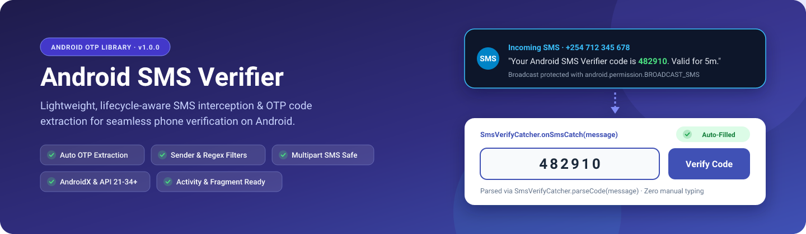
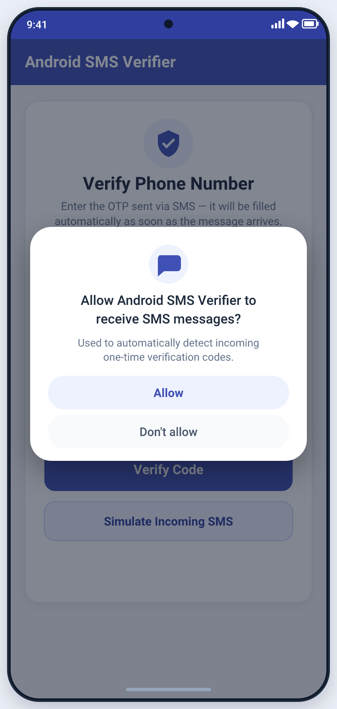
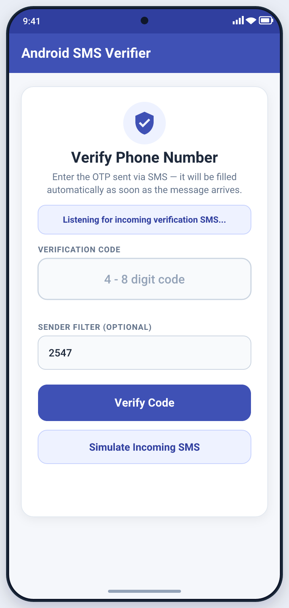
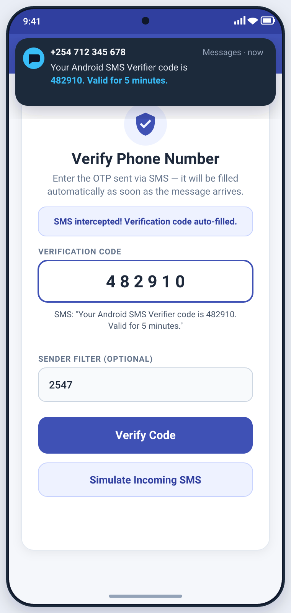
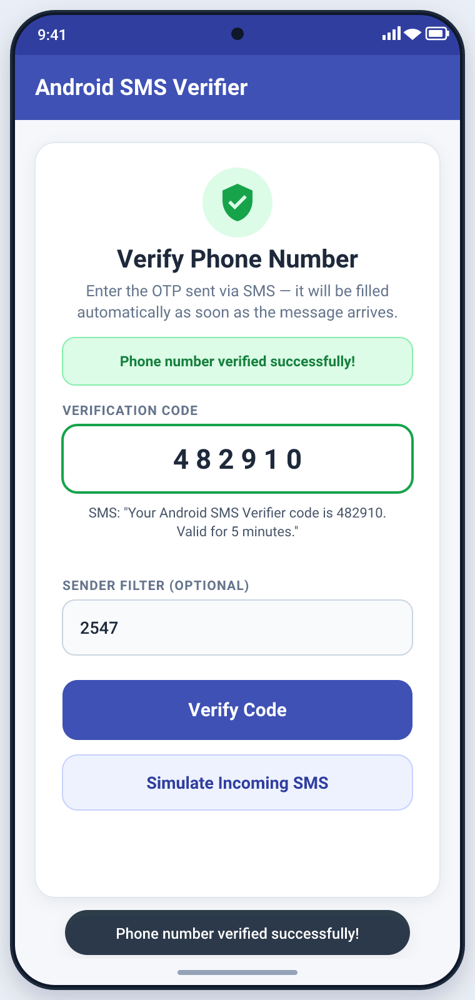

# Android SMS Verifier

<p align="center">
  
</p>

<p align="center">
  
  
  
  
  <a href="LICENSE"></a>
</p>

**Android SMS Verifier** is a lightweight, lifecycle-aware Android library that intercepts incoming SMS verification messages and extracts one-time passwords (OTPs) into your app with just a few lines of Java or Kotlin code.

---

## Features

- **Automatic SMS Interception** — Listens for incoming `SMS_RECEIVED` broadcasts and delivers the message straight to your UI callback.
- **Built-in OTP Code Parser** — Extracts 4–8 digit (or custom-length) numeric codes via `SmsVerifyCatcher.parseCode(...)`.
- **Flexible Sender Filtering** — Match exact shortcodes (`"777"`), country/carrier prefixes (`"2547"`), full international numbers (`"+254712345678"`), or alphanumeric sender IDs (`"AFRICASTKNG"`).
- **Multiline Regex Filtering** — Filter SMS message bodies with regular expressions (`Pattern.DOTALL` enabled for multiline OTP messages).
- **Multipart SMS Safe** — Automatically reassembles multi-PDU (concatenated) SMS messages before filtering and parsing.
- **Hardened & Modern Android Ready** — Migrated to **AndroidX**, guards broadcast registration with `android.permission.BROADCAST_SMS` to prevent third-party intent spoofing, and supports Android 13/14+ (`API 33–34+`) receiver export flags.
- **Activity & Fragment Support** — Works seamlessly in both `Activity` and `androidx.fragment.app.Fragment` lifecycles without leaking `BroadcastReceiver` instances.

---

## Screenshots

| 1. Runtime Permission | 2. Listening for SMS | 3. SMS Auto-Intercepted | 4. Code Verified |
| :---: | :---: | :---: | :---: |
|  |  |  |  |
| Android 6.0+ `RECEIVE_SMS` permission prompt | Waiting for incoming OTP with optional sender filter | Incoming SMS caught & `482910` auto-filled | Verification complete confirmation |

---

## Installation

### Option 1: JitPack

1. Add the JitPack repository to your root `settings.gradle` (or `settings.gradle.kts`):

```groovy
dependencyResolutionManagement {
    repositoriesMode.set(RepositoriesMode.FAIL_ON_PROJECT_REPOS)
    repositories {
        google()
        mavenCentral()
        maven { url 'https://jitpack.io' }
    }
}
```

2. Add the dependency in your app module's `build.gradle`:

```groovy
dependencies {
    implementation 'com.github.Fellow3-1:android-sms-verifier:1.0.0'
}
```

<details>
<summary><b>Kotlin DSL (<code>build.gradle.kts</code>)</b></summary>

```kotlin
dependencies {
    implementation("com.github.Fellow3-1:android-sms-verifier:1.0.0")
}
```
</details>

### Option 2: Local Module

Clone this repository and include `:smsverifier` in your project:

```groovy
dependencies {
    implementation project(':smsverifier')
}
```

---

## Permissions

The `:smsverifier` library manifest automatically declares `RECEIVE_SMS` (with `android.hardware.telephony` marked optional so Wi-Fi tablets remain supported). You can also declare it explicitly in your app's `AndroidManifest.xml`:

```xml
<uses-permission android:name="android.permission.RECEIVE_SMS" />

<!-- Include INTERNET if your app submits the verification code to a backend server -->
<uses-permission android:name="android.permission.INTERNET" />
```

> **Note:** Only `RECEIVE_SMS` is required to intercept incoming verification broadcasts — `READ_SMS` (inbox access) is **not** needed. On Android 6.0 (API 23) and above, `SmsVerifyCatcher` automatically requests runtime permission when `onStart()` runs.

---

## Quick Start

### Java (Activity)

```java
public class MainActivity extends AppCompatActivity {

    private SmsVerifyCatcher smsVerifyCatcher;

    @Override
    protected void onCreate(Bundle savedInstanceState) {
        super.onCreate(savedInstanceState);
        setContentView(R.layout.activity_main);

        EditText etCode = findViewById(R.id.et_code);

        // 1. Initialize SmsVerifyCatcher
        smsVerifyCatcher = new SmsVerifyCatcher(this, new OnSmsCatchListener<String>() {
            @Override
            public void onSmsCatch(String message) {
                String code = SmsVerifyCatcher.parseCode(message); // Extracts 4–8 digit OTP
                if (!code.isEmpty()) {
                    etCode.setText(code);
                    etCode.setSelection(code.length());
                    // Submit verification code to your server
                }
            }
        });
    }

    // 2. Bind lifecycle methods
    @Override
    protected void onStart() {
        super.onStart();
        smsVerifyCatcher.onStart();
    }

    @Override
    protected void onStop() {
        super.onStop();
        smsVerifyCatcher.onStop();
    }

    // 3. Forward runtime permission results (Android 6.0+)
    @Override
    public void onRequestPermissionsResult(int requestCode,
                                           @NonNull String[] permissions,
                                           @NonNull int[] grantResults) {
        super.onRequestPermissionsResult(requestCode, permissions, grantResults);
        smsVerifyCatcher.onRequestPermissionsResult(requestCode, permissions, grantResults);
    }
}
```

### Kotlin (Activity)

```kotlin
class MainActivity : AppCompatActivity() {

    private lateinit var smsVerifyCatcher: SmsVerifyCatcher

    override fun onCreate(savedInstanceState: Bundle?) {
        super.onCreate(savedInstanceState)
        setContentView(R.layout.activity_main)

        val etCode: EditText = findViewById(R.id.et_code)

        smsVerifyCatcher = SmsVerifyCatcher(this) { message ->
            val code = SmsVerifyCatcher.parseCode(message)
            if (code.isNotEmpty()) {
                etCode.setText(code)
                etCode.setSelection(code.length)
            }
        }
    }

    override fun onStart() {
        super.onStart()
        smsVerifyCatcher.onStart()
    }

    override fun onStop() {
        super.onStop()
        smsVerifyCatcher.onStop()
    }

    override fun onRequestPermissionsResult(
        requestCode: Int,
        permissions: Array<out String>,
        grantResults: IntArray
    ) {
        super.onRequestPermissionsResult(requestCode, permissions, grantResults)
        smsVerifyCatcher.onRequestPermissionsResult(requestCode, permissions, grantResults)
    }
}
```

### Using Inside an AndroidX Fragment

```java
public class VerifyFragment extends Fragment {

    private SmsVerifyCatcher smsVerifyCatcher;

    @Override
    public void onViewCreated(@NonNull View view, @Nullable Bundle savedInstanceState) {
        super.onViewCreated(view, savedInstanceState);
        smsVerifyCatcher = new SmsVerifyCatcher(this, message -> {
            String code = SmsVerifyCatcher.parseCode(message, 6); // Expect a 6-digit OTP
            // Update UI with code
        });
    }

    @Override
    public void onStart() {
        super.onStart();
        smsVerifyCatcher.onStart();
    }

    @Override
    public void onStop() {
        super.onStop();
        smsVerifyCatcher.onStop();
    }

    @Override
    public void onRequestPermissionsResult(int requestCode,
                                           @NonNull String[] permissions,
                                           @NonNull int[] grantResults) {
        super.onRequestPermissionsResult(requestCode, permissions, grantResults);
        smsVerifyCatcher.onRequestPermissionsResult(requestCode, permissions, grantResults);
    }
}
```

---

## Filtering & Code Parsing

### Filter by Sender Phone Number, Prefix, or Sender ID

Restrict interception to a specific shortcode, country/carrier prefix, full number, or alphanumeric sender ID (can be updated before or after `onStart()`):

```java
// Match Kenyan mobile prefix (+2547... or 2547...)
smsVerifyCatcher.setPhoneNumberFilter("2547");

// Or match an alphanumeric sender ID (case-insensitive)
smsVerifyCatcher.setPhoneNumberFilter("AFRICASTKNG");

// Clear filter to accept all senders
smsVerifyCatcher.setPhoneNumberFilter(null);
```

### Filter by Message Regular Expression

Only trigger `onSmsCatch` when the SMS body matches a regex pattern (multiline messages with `\n` are supported automatically):

```java
smsVerifyCatcher.setFilter(".*MyApp.*\\b\\d{6}\\b.*");
```

### Parse Verification Codes

```java
// Extract the first standalone 4-to-8 digit code (returns "" if none found)
String otp = SmsVerifyCatcher.parseCode(message);

// Extract a code with an exact length (e.g. 6 digits)
String sixDigitOtp = SmsVerifyCatcher.parseCode(message, 6);
```

---

## API Reference

| Method | Description |
| :--- | :--- |
| `SmsVerifyCatcher(Activity, OnSmsCatchListener<String>)` | Creates an Activity-scoped SMS catcher. |
| `SmsVerifyCatcher(Fragment, OnSmsCatchListener<String>)` | Creates an AndroidX Fragment-scoped SMS catcher. |
| `SmsVerifyCatcher(Activity, Fragment, OnSmsCatchListener<String>)` | Creates an SMS catcher bound to an explicit Activity and Fragment. |
| `onStart()` | Checks/requests `RECEIVE_SMS` permission and registers the broadcast receiver. |
| `onStop()` | Unregisters the broadcast receiver to prevent leaks when backgrounded. |
| `onRequestPermissionsResult(int, String[], int[])` | Handles runtime permission grant results and registers the receiver. |
| `setPhoneNumberFilter(@Nullable String)` | Filters incoming SMS by sender number, prefix, or alphanumeric sender ID. |
| `setFilter(@Nullable String)` | Filters incoming SMS body using a regular expression. |
| `isRegistered()` | Returns `true` if the internal `BroadcastReceiver` is currently active. |
| `SmsVerifyCatcher.parseCode(@Nullable String)` | Static helper that extracts the first 4–8 digit OTP from an SMS string. |
| `SmsVerifyCatcher.parseCode(@Nullable String, int)` | Static helper that extracts an OTP of exact digit count `codeLength`. |

---

## Testing the Sample App

1. Open the project in **Android Studio** (JDK 17+ / Gradle 8.7) and run the `:app` configuration on an emulator or physical device.
2. Grant the SMS permission when prompted.
3. Send a simulated SMS to the Android Emulator via `adb`:

```bash
adb emu sms send +254712345678 "Your Android SMS Verifier code is 482910. Valid for 5 minutes."
```

Or tap **Simulate Incoming SMS** inside the sample app to preview OTP extraction and verification on devices without cellular service.

---

## Project Structure

```text
android-sms-verifier/
├── smsverifier/        # Reusable Android SMS verification library module
├── app/                # Sample Android app demonstrating SmsVerifyCatcher
├── screenshots/        # Project UI & workflow screenshots
├── LICENSE             # MIT License
└── README.md           # Documentation
```

---

## Contributing and Issues

Contributions, bug reports, and pull requests are welcome! Feel free to fork the repository and open a pull request with your improvements.

---

## License

This project is licensed under the [MIT License](LICENSE).
